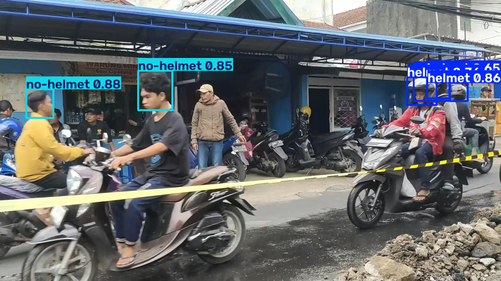

# Analisis Pengaruh Augmentasi Data terhadap Performa YOLOv8

## Ringkasan penelitian

Penelitian ini membandingkan YOLOv8n untuk deteksi penggunaan helm pengendara sepeda motor berbasis web. Dataset memiliki dua kelas: `0 = helmet` dan `1 = no-helmet`. Eksperimen M0–M5 menguji baseline tanpa augmentasi tambahan, augmentasi tunggal, kombinasi augmentasi offline, dan augmentasi online terkontrol. Detail metode, bukti pelaksanaan, keterbatasan, dan metrik tercatat ada di [docs/progress.md](docs/progress.md).

Hasil di bawah disalin dari laporan evaluasi test lokal yang tersedia saat dokumentasi ini diperbarui. Setiap tahap mengevaluasi 92 gambar test. Ini adalah hasil yang tercatat, bukan klaim signifikansi statistik.

| Tahap | Perlakuan | Precision | Recall | mAP50 | mAP50–95 |
|---|---|---:|---:|---:|---:|
| M0 | Baseline, tanpa augmentasi tambahan | 0.817110 | 0.708094 | 0.766207 | 0.377967 |
| M1 | Horizontal flip offline | 0.709798 | 0.678256 | 0.697354 | 0.325731 |
| M2 | Rotasi offline, rentang ±15° | 0.786432 | 0.696881 | 0.749013 | 0.338467 |
| M3 | Brightness 0.8 + contrast 1.2 offline | 0.843268 | 0.726593 | 0.790732 | 0.387333 |
| M4 | Flip + rotasi ±15° + brightness/contrast offline | 0.755783 | 0.636515 | 0.683067 | 0.308553 |
| M5 | Augmentasi online terkontrol | 0.885168 | 0.761842 | 0.837365 | 0.419074 |

Artefak eksperimen dan laporan tersebut berada di folder lokal `experiments/` dan `reports/`, yang saat ini dikecualikan oleh [.gitignore](.gitignore). Angka tabel dapat ditelusuri ke `reports/M0_M1_M2_M3_M4_M5_comparison.csv` dan laporan JSON tiap tahap di mesin tempat eksperimen dijalankan; keduanya tidak tersedia dari clone Git bersih kecuali diunggah terpisah.

## Struktur proyek

Struktur berikut mencerminkan file yang ditemukan di workspace audit. Folder dataset, model, laporan, dan hasil training adalah artefak lokal dan tidak semuanya dilacak Git.

```text
.
├── app.py
├── dataset/                         # lokal, diabaikan Git
│   ├── source/
│   ├── helmet_research/
│   │   ├── data.yaml
│   │   ├── dataset_info.json
│   │   ├── train/{images,labels}/
│   │   ├── val/{images,labels}/
│   │   └── test/{images,labels}/
│   ├── experiments/
│   │   ├── M1_flip/
│   │   ├── M2_rotation/
│   │   ├── M3_brightness_contrast/
│   │   └── M4_compound/
│   └── yolov8-helmet-final-use-no-augmentation.v2-no-augmentasi.yolov8.zip
├── docs/
│   └── progress.md
├── experiments/                     # hasil lokal diabaikan Git, kecuali checkpoint M5 terpilih
│   ├── smoke_test/yolov8n/
│   ├── M0_baseline/
│   ├── M1_flip/
│   ├── M2_rotation/
│   ├── M3_brightness_contrast/
│   ├── M4_compound/
│   └── M5_controlled_augmentation/
├── inference/M5/                    # contoh hasil inferensi lokal
├── reports/                          # lokal, diabaikan Git
├── runs/detect/                      # ada, saat audit kosong
├── scripts/
├── tests/
├── weights/yolo26n.pt                # model lokal; tidak dirujuk oleh script eksperimen
├── yolov8n.pt                        # bobot dasar YOLOv8n lokal
├── requirements-m5.txt
├── requirements-web.txt
└── .gitignore
```

`.venv/`, `__pycache__/`, dan `desktop.ini` juga ditemukan secara lokal, tetapi tidak ditampilkan sebagai bagian struktur sumber karena merupakan environment/cache atau metadata mesin.

### Fungsi folder dan file penting

- `dataset/`: arsip sumber berukuran 272,924,564 byte, split penelitian 635 train / 181 val / 92 test, serta dataset turunan offline M1–M4. Dataset tidak dilacak Git.
- `scripts/`: persiapan dan audit dataset, pembentukan dataset augmentasi, training M0–M5, smoke test, uji inferensi M5, serta pembuatan grafik dan diagram penelitian. Daftar script dan perintahnya ada di [docs/progress.md](docs/progress.md).
- `experiments/`: log training seperti `args.yaml` dan `results.csv`, plot, serta bobot `best.pt`/`last.pt` untuk smoke test dan M0–M5. Hasil tersebut diabaikan Git; hanya checkpoint `best.pt` M5 yang dipilih untuk disertakan.
- `reports/`: konfigurasi eksperimen, audit dataset, evaluasi validation/test, tabel perbandingan, grafik, dan diagram alur.
- `tests/`: unit test validasi transformasi label untuk M1 dan M4.
- `docs/progress.md`: logbook bukti eksperimen, metrik, model lokal, petunjuk eksekusi, dan pekerjaan tersisa.
- `app.py`: aplikasi Streamlit lokal untuk inferensi foto/video menggunakan checkpoint M5.
- `inference/M5/`: keluaran contoh uji inferensi gambar yang disimpan oleh `scripts/test_m5_inference.py`.
- `yolov8n.pt`: bobot dasar yang dirujuk oleh script training. `weights/yolo26n.pt` juga ditemukan, tetapi tidak dirujuk oleh script penelitian yang diperiksa.
- `requirements-web.txt` hanya mencantumkan Streamlit; `requirements-m5.txt` hanya mencantumkan Albumentations. Keduanya bukan daftar lengkap dependensi training/inferensi.

## Menjalankan eksperimen

Gunakan Python environment yang memiliki PyTorch, Ultralytics, Pillow, dan dependensi script terkait. Dataset dan `yolov8n.pt` harus tersedia lokal pada lokasi yang digunakan script.

```powershell
python -m unittest discover -s tests -v
python scripts/prepare_dataset.py
python scripts/smoke_test_yolov8.py
python scripts/train_m0_baseline.py
python scripts/create_m1_flip_dataset.py
python scripts/audit_m1_dataset.py
python scripts/train_m1_flip.py
python scripts/create_m2_rotation_dataset.py
python scripts/train_m2_rotation.py
python scripts/create_m3_brightness_contrast_dataset.py
python scripts/train_m3_brightness_contrast.py
python scripts/create_m4_compound_dataset.py
python scripts/audit_m4_dataset.py
python scripts/train_m4_compound.py
python scripts/train_m5_controlled_augmentation.py --preflight
python scripts/train_m5_controlled_augmentation.py --train
python scripts/create_m0_m5_comparison_chart.py
python scripts/create_research_flowchart.py
```

Perintah training dan pembentukan dataset di atas menjalankan pekerjaan komputasi dan dapat membuat keluaran baru. Jangan jalankan ulang tanpa memeriksa guard/keluaran yang sudah ada pada script. Tahapan M0–M5 dalam tabel merupakan hasil dari artefak lokal yang telah ditemukan, bukan akibat menjalankan ulang perintah saat audit.

## Menjalankan aplikasi web

Aplikasi memilih checkpoint `experiments/M5_controlled_augmentation/weights/best.pt`. Meskipun pola `.gitignore` mengabaikan direktori eksperimen dan file `*.pt`, checkpoint M5 ini disiapkan sebagai satu-satunya model yang dilacak di repository; setelah perubahan ini di-commit dan di-push, file tersedia pada clone bersih. Untuk aplikasi, sediakan juga PyTorch, Ultralytics, OpenCV, Pillow, serta FFmpeg di `PATH` untuk fitur video. Instalasi `requirements-web.txt` saja hanya memasang Streamlit, bukan seluruh dependensi tersebut.

```powershell
python -m pip install -r requirements-web.txt
python -m streamlit run app.py
```

Pilih Foto atau Video, lalu atur confidence threshold dan image size. Foto JPG/JPEG/PNG menampilkan gambar asli, hasil anotasi, statistik, dan detail deteksi. Video MP4/AVI/MOV diproses frame-by-frame; hasil dan statistik ditampilkan di aplikasi. Berkas sementara video dikelola dalam temporary directory. Aplikasi memakai CUDA device 0 jika tersedia dan CPU sebagai fallback.

Uji inferensi gambar melalui script terpisah:

```powershell
python scripts/test_m5_inference.py --source path\ke\gambar.jpg --conf 0.25
```

Script menyimpan gambar beranotasi di `inference/M5/run_<id>/`.

## Distribusi model

Checkpoint M5 yang digunakan aplikasi berukuran sekitar 5.94 MiB dan cukup kecil untuk Git biasa. Pola `.gitignore` tetap mengecualikan `experiments/`, `*.pt`, `dataset/`, dan `reports/`; hanya checkpoint M5 yang dipilih untuk ditambahkan secara eksplisit. Git LFS tidak diperlukan untuk file ini. Dataset, laporan, log training, dan checkpoint lain tidak termasuk dalam distribusi. Inventaris checkpoint tercantum di [docs/progress.md](docs/progress.md).

## Contoh hasil inferensi YOLOv8 M5

Gambar berikut merupakan hasil inferensi model YOLOv8 M5 pada foto pengujian.


